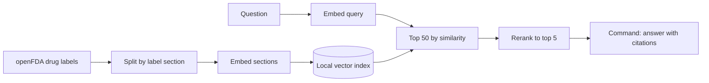

# Drug Label RAG Eval

Question answering over FDA drug labels with Cohere Embed, Rerank and Command, plus an eval harness that measures what each stage adds: whether retrieval finds the right label section with and without reranking, whether answers are correct and their citations hold up, whether the system declines questions the labels can't answer, and how long each stage takes.

> Independent project, not affiliated with or endorsed by Cohere or the U.S. Food and Drug Administration. Answers are generated from drug labels for demonstration only and are not medical advice.

## Results

<!--
Fill in from results/ after the final eval run.
n is small, so give counts with percentages (41/50, 82%) and say which gaps are within noise.
-->

Eval set: 50 questions with a known answer and 10 the labels can't answer, over _N_ labels split into _M_ sections.

| | Embed only | Embed + Rerank |
|---|---|---|
| Right section in the top 5 (hit@5) | _TBD_ | _TBD_ |
| Right section ranked first (hit@1) | _TBD_ | _TBD_ |
| Right section anywhere in the top 50 | _TBD_ | — |
| Answer correct | _TBD_ | _TBD_ |
| Citations that contain the answer | _TBD_ | _TBD_ |
| Unanswerable questions declined | _TBD_ | _TBD_ |
| Answerable questions wrongly declined | _TBD_ | _TBD_ |

Rerank only reorders the top 50, so the top-50 row is the ceiling on what reranking can recover.

Latency per stage (ms):

| Stage | p50 | p95 |
|---|---|---|
| Embed query | _TBD_ | _TBD_ |
| Vector search | _TBD_ | _TBD_ |
| Rerank | _TBD_ | _TBD_ |
| Generate answer | _TBD_ | _TBD_ |
| End to end | _TBD_ | _TBD_ |

<!-- Say where latency was measured from (trial key, home connection). -->

## How it works

| Stage | Model |
|---|---|
| Embed label sections (once) | `embed-v5.0-pro`, 2048 dimensions |
| Embed questions | `embed-v5.0-fast`, which shares Pro's embedding space |
| Rerank | `rerank-v5.0-pro` |
| Answer | `command-a-plus-05-2026` |

`python -m labelrag.smoke` checks a key against all of these, plus `rerank-v5.0-fast`, with one call each.

## Eval set

[`eval/questions.jsonl`](eval/questions.jsonl) holds 60 hand-written questions. The 50 answerable ones are each tagged with the label and section that holds the answer. The other 10 can't be answered from the corpus and check whether the system declines instead of guessing.

<!--
How the questions were written (from the label text, before running retrieval), what makes some of them hard (brand vs generic names, facts that appear in more than one section), and one example row.
-->

## Metrics

- **hit@k**: the gold section is among the top k retrieved sections.
- **Answer correct**: <!-- how it's graded, and how the grader was checked against hand labels -->
- **Citation contains the answer**: the cited passage, read on its own, supports the answer.
- **Declined**: the answer says the labels don't cover the question instead of guessing.
- **Latency**: wall-clock time per stage across the eval set.

## Design decisions

<!--
A few bullets, each with its reason. Candidates: chunking by label section; how duplicate labels for the same drug are handled; a different embedding model for questions than for documents; top 50 then rerank to 5; a local numpy index instead of a vector database; caching every API call to stay inside the trial key's 1,000 calls a month.
-->

## What I'd change next

<!-- What is still unfinished, plus what the results point to. -->

## Reproduce

<!-- Fill in once the scripts exist: venv, pip install, copy .env.example to .env, then fetch, index, eval. -->

## Data

Labels come from the [openFDA drug label API](https://open.fda.gov/apis/drug/label/): public data that contains no patient information. The raw download and the vectors aren't committed. `data/manifest.csv` records which labels were used and their versions, and the scripts rebuild everything else.
