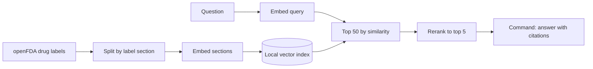

# Drug Label RAG Eval

Question answering over FDA drug labels with Cohere Embed, Rerank and Command, plus an eval harness that measures what each stage adds: whether retrieval finds the right label section with and without reranking, whether answers are correct and their citations hold up, whether the system declines questions the labels can't answer, and how long each stage takes.

> Independent project, not affiliated with or endorsed by Cohere or the U.S. Food and Drug Administration. Answers are generated from drug labels for demonstration only and are not medical advice.

## Results

<!--
Fill in from results/ after the final eval run.
n is small, so give counts with percentages (41/50, 82%) and say which gaps are within noise.
-->

Eval set: 50 questions with a known answer and 10 the labels can't answer, over _N_ labels split into _M_ sections.

| | Embed only | Embed + Rerank |
|---|---|---|
| Right section in the top 5 (hit@5) | _TBD_ | _TBD_ |
| Right section ranked first (hit@1) | _TBD_ | _TBD_ |
| Right section anywhere in the top 50 | _TBD_ | — |
| Answer correct | _TBD_ | _TBD_ |
| Citations that contain the answer | _TBD_ | _TBD_ |
| Unanswerable questions declined | _TBD_ | _TBD_ |
| Answerable questions wrongly declined | _TBD_ | _TBD_ |

Rerank only reorders the top 50, so the top-50 row is the ceiling on what reranking can recover.

Latency per stage (ms):

| Stage | p50 | p95 |
|---|---|---|
| Embed query | _TBD_ | _TBD_ |
| Vector search | _TBD_ | _TBD_ |
| Rerank | _TBD_ | _TBD_ |
| Generate answer | _TBD_ | _TBD_ |
| End to end | _TBD_ | _TBD_ |

<!-- Say where latency was measured from (trial key, home connection). -->

## How it works



| Stage | Model |
|---|---|
| Embed label sections (once) | `embed-v5.0-pro`, 2048 dimensions |
| Embed questions | `embed-v5.0-fast`, which shares Pro's embedding space |
| Rerank | `rerank-v5.0-pro` |
| Answer | `command-a-plus-05-2026` |

`python -m labelrag.smoke` checks a key against all of these, plus `rerank-v5.0-fast`, with one call each.

## Eval set

[`eval/questions.jsonl`](eval/questions.jsonl) holds 60 questions written from the label text before any retrieval ran on them. The 50 answerable ones are each tagged with the label and section that holds the answer. The other 10 can't be answered from the corpus and check whether the system declines instead of guessing.

Each line of the file is one JSON object:

| Field | Needed for | What it holds |
|---|---|---|
| `id` | every question | A unique ID, such as `q07` |
| `question` | every question | The question, worded the way someone would ask it |
| `answerable` | every question | `false` for the questions the labels can't answer |
| `gold` | answerable ones | One or more `{"set_id", "section"}` locations that hold the answer. A fact can sit in more than one label: a combination pill repeats its components' text, and products that share an active ingredient share text. |
| `answer` | answerable ones | A reference answer |
| `key_facts` | answerable ones | Short phrases from the label text that a correct answer has to contain |
| `tags` | optional | What makes an answerable question hard, or what makes an unanswerable one tempting to answer. [`eval/README.md`](eval/README.md) defines each tag. |
| `notes` | optional | Anything else |

Two format examples, not from the eval set:

```json
{"id": "q00", "question": "What is the recommended initial dose of Avapro?", "answerable": true, "gold": [{"set_id": "7885b2a8-be4e-48ab-8113-4e6ab791eb98", "section": "dosage_and_administration"}], "answer": "150 mg once daily.", "key_facts": ["150 mg once daily"], "tags": []}
{"id": "u00", "question": "How much does a month of Avapro cost?", "answerable": false, "tags": []}
```

`python -m labelrag.questions` checks the file: unique IDs, required fields, and gold locations that exist in the corpus. Once the sections are built, it also warns when a key fact isn't in the gold text word for word, and when every key fact also appears in a section that isn't listed as gold, either elsewhere in the same label or in a label with the same active ingredient. Questions tagged `near_duplicate` skip the second half of that check, because their relatives were left out of gold on purpose. `python -m labelrag.questions find <name>` gives a label's set_id and DailyMed link, and `python -m labelrag.questions show <label> <section>` prints a section exactly as it's indexed.

Most of the answerable questions are hard in a specific, tagged way. 26 have near-identical text under a sibling label's name, 7 ask about something the current label says differently from older labels or common knowledge, and 7 rest on a false premise the answer has to correct. 11 are plain lookups, kept as a baseline. [`eval/README.md`](eval/README.md) explains each group and what a grader needs to watch for.

## Metrics

- **hit@k**: the gold section is among the top k retrieved sections.
- **Answer correct**: graded by hand as right, partly right or wrong, with partly right counted as wrong. The rubric is in [`eval/README.md`](eval/README.md#notes-for-grading): a wrong yes or no is wrong even when the right passage is quoted, and declining a question with a false premise is wrong, since the label corrects it. Claude graded the same answers as a second grader, after the hand grades were in, and the two agree on 94 of 102 distinct answers (Cohen's kappa 0.71). An automatic check, whether the answer contains every key fact word for word, agrees with either grader at kappa 0.47. It misses paraphrases, so it undercounts: 32 and 35 of 50 right, against 42 and 42 by hand. After grading, `python -m labelrag.evaluate --run <name> --regrade` re-scores a run with no API calls.
- **Citation contains the answer**: the cited chunks contain every key fact, checked automatically. That check is reliable, because the key facts are copied from the chunk text. An answer that cites nothing counts as no.
- **Declined**: the answer says the labels don't cover the question instead of guessing.
- **Latency**: wall-clock time per stage across the eval set.

## Design decisions

<!--
A few bullets, each with its reason. Candidates: chunking by label section; how duplicate labels for the same drug are handled; a different embedding model for questions than for documents; top 50 then rerank to 5; a local numpy index instead of a vector database; caching every API call to stay inside the trial key's 1,000 calls a month.
-->

## What I'd change next

<!-- What is still unfinished, plus what the results point to. -->

## Reproduce

<!-- Fill in once the scripts exist: venv, pip install, copy .env.example to .env, then fetch, index, eval. -->

## Data

Labels come from the [openFDA drug label API](https://open.fda.gov/apis/drug/label/): public data that contains no patient information. The raw download and the vectors aren't committed. `data/manifest.csv` records which labels were used and their versions, and the scripts rebuild everything else.
