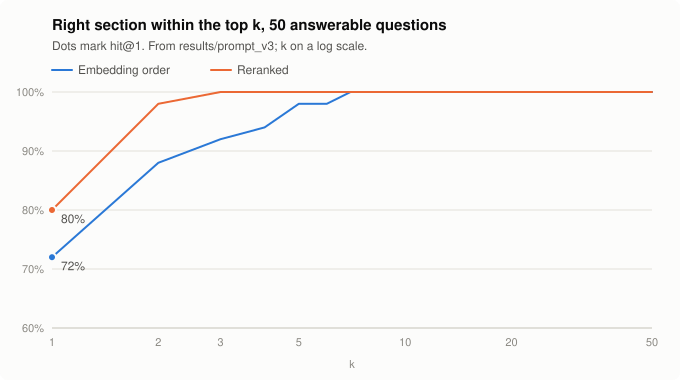
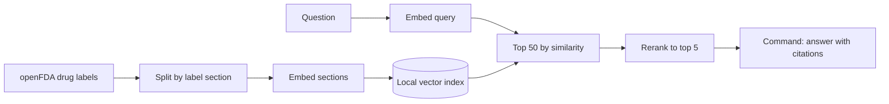

# Drug Label RAG Eval

Question answering over FDA drug labels with Cohere Embed, Rerank and Command, plus an eval harness that measures what each stage adds: whether retrieval finds the right label section with and without reranking, whether answers are correct and their citations hold up, whether the system declines questions the labels can't answer, and how long each stage takes.

> Independent project, not affiliated with or endorsed by Cohere or the U.S. Food and Drug Administration. Answers are generated from drug labels for demonstration only and are not medical advice.

## Results

Eval set: 50 questions with a known answer and 10 the labels can't answer, over 120 labels split into 5,730 chunks. The final pipeline answers with prompt v3 ([`prompts/answer_v3.md`](prompts/answer_v3.md)):

| | Embed only | Embed + Rerank |
|---|---|---|
| Right section in the top 5 (hit@5) | 49/50 (98%) | 50/50 (100%) |
| Right section ranked first (hit@1) | 36/50 (72%) | 40/50 (80%) |
| Right section anywhere in the top 50 | 50/50 (100%) | — |
| Answer correct | 45/50 (90%) | 47/50 (94%) |
| Citations that contain the answer | 38/49 (78%) | 37/50 (74%) |
| Unanswerable questions declined | 10/10 (100%) | 7/10 (70%) |
| Answerable questions wrongly declined | 1/50 (2%) | 0/50 (0%) |

Rerank only reorders the top 50, so the top-50 row is the ceiling on what reranking can recover. With 50 questions, most gaps between the two columns are within noise: McNemar's exact test gives p = 0.34 for hit@1 (3 questions only embedding got right, 7 only rerank did) and p = 0.5 for answer correctness. The three unanswerable questions that weren't declined with rerank weren't answered either: Cohere returned a 422, "no valid response generated", which the eval counts as a failure. Every 422 so far has come on an unanswerable question.

<picture>
  <source media="(prefers-color-scheme: dark)" srcset="docs/hit-at-k-dark.svg">
  
</picture>

Rerank's gain is at the top of the list: every question has its gold section in the reranked top 3, while the embedding order needs the top 7. Both reach 100% well before 50 candidates. `python -m labelrag.chart` redraws the chart from `results/`.

Latency per stage, embed + rerank pipeline (ms):

| Stage | p50 | p95 |
|---|---|---|
| Embed query | 83 | 98 |
| Vector search | 1 | 1 |
| Rerank (50 chunks) | 374 | 454 |
| Generate answer | 1,337 | 2,428 |
| End to end | 1,797 | 2,913 |

Embedding only, end to end: 1,448 ms p50, 2,755 ms p95. Measured from my home connection on a trial key, one request at a time, across all 60 questions. Embedding and rerank times come from the first run (later runs read them from the cache), generation times from the prompt v3 run.

### Three prompt versions

The first run (prompt v1) declined questions whose premise the label contradicts, instead of correcting them: asked for a type 1 diabetes dose of Jardiance, it said the labels don't answer the question, though Jardiance's label says it isn't recommended for type 1 diabetes. v2 and v3 were written from the graded failures:

| Prompt | Answer correct, embed only | Answer correct, rerank | Wrongly declined | Cited nothing | Generate p50 |
|---|---|---|---|---|---|
| v1 | 40/50 | 38/50 | 6 and 8 | 6/44 and 5/42 | 1.2 s |
| v2 | 42/50 | 43/50 | 6 and 5 | 10/44 and 8/45 | 1.5 s |
| v3 | 45/50 | 47/50 | 1 and 0 | 10/49 and 11/50 | 1.3 s |

v3 against v1 with rerank is the only difference here that clears noise (McNemar p = 0.012; 0.125 with embedding only). Two caveats: v2 and v3 were written after reading v1's failures on these same 60 questions, so their gains are an optimistic estimate of how they'd do on new questions; and answers that cite nothing went up from v1. Each prompt was committed before its run, and [`results/`](results/) has every answer, its grades and a comparison against the earlier version.

### Retrieval experiments

One setting changed at a time, retrieval only, on the same 50 answerable questions (`python -m labelrag.experiment`):

| Change | hit@1 | hit@5 | Latency of the changed stage, p50 | Takeaway |
|---|---|---|---|---|
| None (Embed Fast queries, Rerank Pro) | 72% embedding, 80% reranked | 98% and 100% | 82 ms query, 374 ms rerank | The pipeline as built |
| Embed Pro for the queries | 74% embedding (p = 1.0) | 96% (p = 1.0) | 94 ms vs 82 ms | Fast queries against a Pro index lose nothing measurable |
| Rerank Fast instead of Pro | 82% reranked (p = 1.0) | 98% reranked (p = 1.0) | 263 ms vs 374 ms | No measurable loss on 50 questions, and about 110 ms faster |
| Chunks without the drug-name header | 70% embedding, 78% reranked | 96% and 96% (p = 0.5 reranked) | | Within noise overall, but every question asked by generic name about a brand-named passage ranks lower ([Design decisions](#design-decisions)) |

Latency in each row is the stage's own p50 from single calls. The experiments' rows and summaries are in [`results/experiments/`](results/experiments/).

## How it works



| Stage | Model |
|---|---|
| Embed label sections (once) | `embed-v5.0-pro`, 2048 dimensions |
| Embed questions | `embed-v5.0-fast`, which shares Pro's embedding space |
| Rerank | `rerank-v5.0-pro` |
| Answer | `command-a-plus-05-2026`, temperature 0 and a fixed seed |

`python -m labelrag.smoke` checks a key against all of these, plus `rerank-v5.0-fast`, with one call each.

## Eval set

[`eval/questions.jsonl`](eval/questions.jsonl) holds 60 questions written from the label text before any retrieval ran on them. The 50 answerable ones are each tagged with the label and section that holds the answer. The other 10 can't be answered from the corpus and check whether the system declines instead of guessing.

Each line of the file is one JSON object:

| Field | Needed for | What it holds |
|---|---|---|
| `id` | every question | A unique ID, such as `q07` |
| `question` | every question | The question, worded the way someone would ask it |
| `answerable` | every question | `false` for the questions the labels can't answer |
| `gold` | answerable ones | One or more `{"set_id", "section"}` locations that hold the answer. A fact can sit in more than one label: a combination pill repeats its components' text, and products that share an active ingredient share text. |
| `answer` | answerable ones | A reference answer |
| `key_facts` | answerable ones | Short phrases from the label text that a correct answer has to contain |
| `tags` | optional | What makes an answerable question hard, or what makes an unanswerable one tempting to answer. [`eval/README.md`](eval/README.md) defines each tag. |
| `notes` | optional | Anything else |

One row from the set (its `notes` field left out), and the kind of mistake it's there to catch:

```json
{"id": "q05", "question": "Is Mounjaro approved for weight loss?", "answerable": true, "gold": [{"set_id": "d2d7da5d-ad07-4228-955f-cf7e355c8cc0", "section": "indications_and_usage"}], "answer": "No. Mounjaro is indicated, with diet and exercise, to improve glycemic control in adults and children 10 and older with type 2 diabetes, and to reduce the risk of major adverse cardiovascular events in adults with type 2 diabetes at high risk of them. Weight loss isn't one of its indications.", "key_facts": ["improve glycemic control", "pediatric patients 10 years of age and older", "reduce the risk of major adverse cardiovascular"], "tags": ["false_premise", "near_duplicate"]}
```

Zepbound is the same drug and is approved for weight management, and Mounjaro's own trials report weight loss, so an answer from the wrong label or from the trial section says yes. Prompt v1 declined it; v2 and v3 say no, from the indications.

`python -m labelrag.questions` checks the file: unique IDs, required fields, and gold locations that exist in the corpus. Once the sections are built, it also warns when a key fact isn't in the gold text word for word, and when every key fact also appears in a section that isn't listed as gold, either elsewhere in the same label or in a label with the same active ingredient. Questions tagged `near_duplicate` skip the second half of that check, because their relatives were left out of gold on purpose. `python -m labelrag.questions find <name>` gives a label's set_id and DailyMed link, and `python -m labelrag.questions show <label> <section>` prints a section exactly as it's indexed.

Most of the answerable questions are hard in a specific, tagged way. 26 have near-identical text under a sibling label's name, 7 ask about something the current label says differently from older labels or common knowledge, and 7 rest on a false premise the answer has to correct. 11 are plain lookups, kept as a baseline. [`eval/README.md`](eval/README.md) explains each group and what a grader needs to watch for.

## Metrics

- **hit@k**: the gold section is among the top k retrieved sections.
- **Answer correct**: graded as right, partly right or wrong, with partly right counted as wrong. The rubric is in [`eval/README.md`](eval/README.md#notes-for-grading): a wrong yes or no is wrong even when the right passage is quoted, and declining a question with a false premise is wrong, since the label corrects it. I graded the first run's 102 distinct answers by hand, and Claude graded them again as a second grader, after my grades were in. We agree on 94 of 102 (Cohen's kappa 0.71), and where we differ, Claude is the stricter one, so its grades are the ones in the tables above, for all three prompt versions. An automatic check, whether the answer contains every key fact word for word, agrees with either of us at kappa 0.47; it misses paraphrases, so it undercounts. After grading, `python -m labelrag.evaluate --run <name> --regrade` re-scores a run with no API calls.
- **Citation contains the answer**: the cited chunks contain every key fact, checked automatically. That check is reliable, because the key facts are copied from the chunk text. An answer that cites nothing counts as no.
- **Declined**: the answer is the fixed sentence the prompt asks for when the excerpts don't answer the question ("The provided label excerpts don't answer this question.").
- **Latency**: wall-clock time per stage across the eval set, one request at a time.

## Design decisions

- **One label per FDA approval, not per active ingredient.** Grouping by ingredient would merge different products: Proscar and Propecia are both finasteride (an enlarged prostate at 5 mg, hair loss at 1 mg), and Viagra and Revatio are both sildenafil. Labels that share an NDA or BLA number are one product; the brand-named label wins, then the newest. Metformin's 22 original-manufacturer labels come down to 16 approvals.
- **A filtered corpus.** From openFDA's 262,909 labels: 81,073 have an `openfda` block (every later filter reads it), 34,487 of those are prescription, 16,093 come from the original manufacturer rather than a repackager, 3,441 are under an NDA or BLA rather than a generic approval, 158 contain an ingredient from six themes (diabetes, blood thinners, cholesterol, urology, blood pressure ARBs, migraine), 151 use the current section format, and one per approval leaves 120. The `openfda` block is missing from about 39% of labels updated since 2024, so Eliquis, Crestor, Ozempic injection, Wegovy, Repatha, Flomax, Avodart, Onglyza and Ubrelvy aren't in the corpus. Three of the unanswerable questions ask about exactly these, to see whether the system answers from a relative's label instead.
- **Chunks follow the label's sections**, up to 2,000 characters, split at subsection headings first and then at sentences, so a chunk rarely mixes topics. Each chunk is embedded with a header naming the brand, the generic name and the section. A passage often names the drug only one way (Leqvio's dosing section says LEQVIO, while someone may ask about inclisiran), and near-identical text appears under several brands, so the header is what ties a chunk to its product. Re-embedding the corpus without it left the overall numbers within noise, but all four questions asked by generic name about a brand-named passage ranked lower: their gold sections fell from reranked ranks 1, 2, 2 and 1 to 15, 41, 5 and 4. Plain lookups did slightly better without it (10 of 11 ranked first, against 8), so the header isn't free, but it does the job it was added for.
- **Embed Pro for the labels, Embed Fast for questions.** The two share an embedding space, so the index is built once with the stronger model and each question uses the cheaper, faster one. The retrieval experiment above checks that this costs nothing.
- **Top 50 by similarity, reranked to 5.** Embedding search is cheap and recalls widely (every gold section was in the top 50); rerank orders that pool, and the answer sees only the top 5.
- **A local numpy index, not a vector database.** 5,730 vectors of 2,048 floats are 46 MB, and exact cosine similarity over all of them takes about a millisecond.
- **Every API call is cached on disk and counted.** The trial key allows 1,000 calls a month. Re-running a finished eval makes no calls and gives the same numbers, and a ledger keeps the month's count exact; the whole project, three prompt versions and three experiments included, used 787.
- **Questions first.** The eval set was written and committed before any retrieval ran, and each prompt version was committed before its run, so the history shows what was decided before seeing results.

## What I'd change next

- **A held-out question set.** v2 and v3 were tuned on the questions they're scored on. Twenty new questions, written before looking at v3's answers, would show how much of the gain carries over.
- **More questions.** With 50, only one comparison here clears p < 0.05. Rerank's hit@1 gain (36 to 40 of 50) would need a few hundred questions to confirm or rule out.
- **Try Rerank Fast in the pipeline.** It matched Pro on these 50 questions and saved about 110 ms a question; a larger set would show whether there's a small quality gap.
- **Treat Cohere's 422 on a decline as a decline,** and check it doesn't hide real failures. All of them so far came on unanswerable questions.
- **Citations.** 10 to 11 v3 answers cite nothing, up from 5 to 6 with v1, even when they paraphrase the label. The longer prompt may be the cause; Command's stricter citation mode isn't available for this model.
- **A failure analysis that sorts every remaining miss by cause:** retrieval, the wrong label, a yes or no that contradicts the rest of the answer (Glucotrol XL, "Does that mean it isn't working?", still opens with "Yes"), or a false premise accepted.
- **Grade the later runs by hand too.** I graded the first run myself; v2 and v3 carry Claude's grades only.
- **Fill the corpus gaps** by adding the labels without an `openfda` block by hand, so Eliquis and Crestor can be asked about.

## Reproduce

Python 3.12 or later. On Windows, activate with `.venv\Scripts\activate` instead.

```bash
python -m venv .venv
source .venv/bin/activate
pip install -e ".[dev]"
pytest
```

The tests need no network and no API key. To run the pipeline, copy `.env.example` to `.env`, add a Cohere key, then:

```bash
python -m labelrag.config      # checks the setup without printing the key
python -m labelrag.fetch       # the 120 labels pinned in data/manifest.csv, from openFDA
python -m labelrag.chunk       # 5,730 chunks into data/processed/
python -m labelrag.index       # 60 embed calls
python -m labelrag.evaluate --run my_run --prompt answer_v3
```

A full eval run from an empty cache is about 240 calls: 60 query embeddings, 60 reranks and 120 answers. I checked these steps from a fresh clone: the labels downloaded at their pinned versions, the chunks came out byte for byte the same, and with my call cache copied in, the eval reproduced all 120 v3 answers and every automatic metric without an API call. The retrieval experiments are in `python -m labelrag.experiment --help`, and `python -m labelrag.usage` shows the month's call count.

## Data

Labels come from the [openFDA drug label API](https://open.fda.gov/apis/drug/label/): public data that contains no patient information. The raw download and the vectors aren't committed. `data/manifest.csv` records which labels were used and their versions, and the scripts rebuild everything else. openFDA serves only each label's current version, so `python -m labelrag.fetch` warns when a label has changed since the manifest pinned it; from then on, a rebuild can drift from the committed results.
